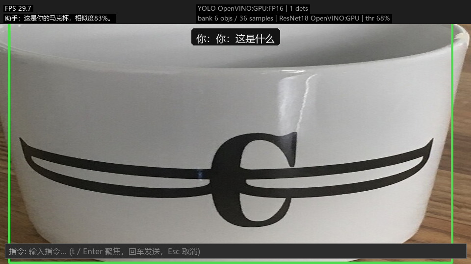
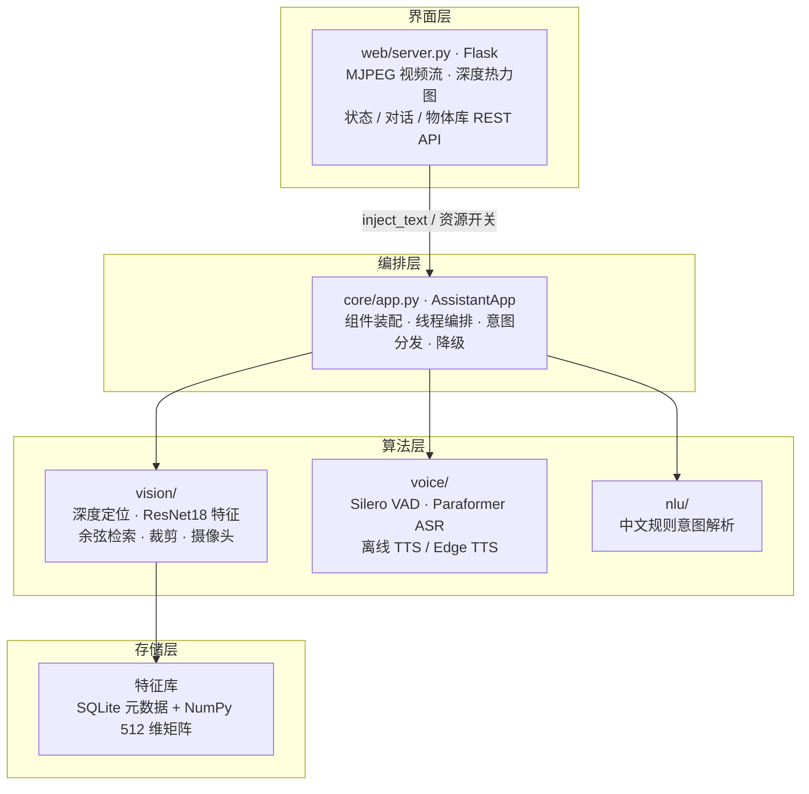
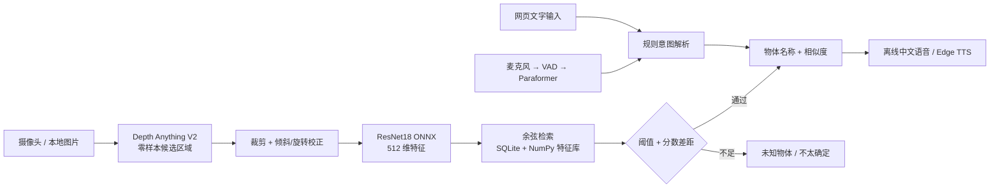

# 离线物体识别与语音助手 · 课堂展示版

> 计算机视觉课程大作业 · 选题一 · Windows / CPU / 本地推理
>
> `release/classroom-demo` 分支：只保留课堂演示所需的组件。用摄像头举起物体说
> 「记住这个叫手机」录入几张，之后说「这是什么」即可认出并播报名称与相似度。
> **定位靠单目深度（零类别），身份靠 ResNet18 特征检索（零样本）**——整条识别
> 链路不依赖任何预训练类别词表。



## 项目架构

分层设计：**编排层不含算法、算法层不感知界面**，因此 `vision/` 和 `voice/`
可以脱离网页与摄像头独立测试（`tools/` 下的测试脚本正是这么做的）。



| 层 | 职责 | 不做什么 |
| --- | --- | --- |
| `web/` | HTTP 服务、MJPEG 编码、页面渲染 | 不做识别、不做业务判断 |
| `core/` | 线程编排、生命周期、组件装配、降级 | 不含视觉/语音算法、不画 GUI |
| `vision/` `voice/` | 算法实现 | 不感知 Flask，不直接控制线程 |
| `nlu/` | 文本 → 意图 | 不访问摄像头或特征库 |
| `vision/memory.py` | 特征落盘与余弦检索 | 不做 UI、不做线程调度 |

**线程模型**：`AssistantApp` 最多 4 个 daemon 线程，加上 Web 自带的渲染线程。

| 线程 | 频率 | 职责 |
| --- | --- | --- |
| Flask 主线程 | 请求驱动 | 处理 REST，不跑推理 |
| web-frames | ~30 FPS | 取最新帧、画框、JPEG 编码 |
| camera | 尽可能快 | 覆盖式写最新帧缓冲（宁可丢帧也不积压延迟） |
| depth | ~2 Hz | 低分辨率深度图供热力图 |
| voice | VAD 端点触发 | mic → VAD → ASR → 意图队列 |
| intent | 队列驱动 | 识别 / 录入 / 查找，真正跑 ResNet18 |

**核心约束**：渲染路径只做「取最新帧 → 编码 JPEG」，从不等待推理；深度、ASR、
ResNet18 都在按需触发的独立线程上，界面帧率与推理速度解耦。暂停识别时，总开关
会一并释放摄像头、麦克风、深度推理与 MJPEG 编码这几个主要 CPU 消耗点。

## 快速开始（三条命令）

在**项目根目录**用 **PowerShell**（建议 Python 3.10 / 3.11）：

```powershell
python -m venv .venv
.\.venv\Scripts\Activate.ps1
python -m pip install -r requirements.txt
```

**一次性准备模型**（需联网下载一次，之后运行完全离线）：

```powershell
python tools/prepare_models.py
```

脚本默认走**国内镜像**，且每个文件都带「镜像失败自动回退官方源」的兜底，单个镜像挂掉不会卡住部署：

| 模型文件 | 国内镜像 | 官方兜底 |
| --- | --- | --- |
| Depth Anything V2 ONNX | `hf-mirror.com` | `huggingface.co` |
| Paraformer 中文 ASR 包 | `gh-proxy.com`（备 `ghproxy.net`） | `github.com` |
| Silero VAD ONNX | `gh-proxy.com`（备 `ghproxy.net`） | `github.com` |

可用环境变量覆盖镜像（镜像不可用时也可手动指定）：

```powershell
$env:HF_ENDPOINT = "https://hf-mirror.com"          # HuggingFace 镜像端点
$env:GH_PROXY = "https://gh-proxy.com/"              # GitHub Release 代理
$env:RESNET18_WEIGHT_MIRROR = "<你信任的 resnet18-f37072fd.pth 国内地址>"  # 可选，见下
```

> **ResNet18 权重说明**：`--resnet18` 需要 ImageNet 预训练权重 `resnet18-f37072fd.pth`。
> torchvision 默认从 `download.pytorch.org` 拉取；若部署机无法访问，设置
> `RESNET18_WEIGHT_MIRROR` 指向你有权限访问的同名权重地址，脚本会先下到 torch 缓存
> 再离线导出。也可自行把该文件放到 `torch.hub.get_dir()/checkpoints/` 下，导出即完全离线。
> （HuggingFace 上的 `resnet18` 权重键名与 torchvision 不兼容，故不直接作为镜像。）

这会备齐三个运行模型：

| 路径 | 用途 |
| --- | --- |
| `models/resnet18/resnet18.onnx` | 512 维特征提取（`--resnet18`，需临时安装 torch/torchvision 导出一次） |
| `models/depth_anything_v2/depth_anything_v2_vits.onnx` | 单目深度 / 零样本定位（`--depth`） |
| `models/sherpa-onnx-paraformer-zh-int8/` | 中文 ASR（`--asr`） |
| `models/silero_vad/silero_vad.onnx` | 语音端点检测（`--asr` 一同准备） |

> 拷机器演示：把整个 `.venv/` 和 `models/` 目录拷到课堂电脑即可，**运行时不需要网络**。
> `models/`、`data/` 不入库，新克隆必须重新准备。

**启动网页**（默认摄像头索引 0、系统默认麦克风）：

```powershell
python web/server.py --config config/demo.yaml
```

浏览器打开 <http://127.0.0.1:5000>。`Ctrl+C` 停止。常用选项：

```powershell
# 先不占摄像头/麦克风，需要时再在网页上点开关（调试最稳）
python web/server.py --config config/demo.yaml --no-camera --no-mic
# 不用语音输入，仅网页文字输入
python web/server.py --config config/demo.yaml --no-voice
# 换端口 / 指定初始设备（也可在网页「设备设置」里随时切换）
python web/server.py --config config/demo.yaml --port 5001 --camera-index 1 --mic-device 8
```

`--mic-device` 可填 sounddevice 的设备索引或名称；`config/demo.yaml` 中的
`app.camera_index` / `asr.mic_device` 是对应默认值，网页上的选择即时生效、无需重启。

## 课堂演示话术（建议提前彩排）

1. 打开页面，确认右上角状态灯：**ResNet18 / Depth** 亮起表示模型就绪。
2. 把物体完整举到镜头前，说或输入「**记住这个，这是手机**」。缓慢转动，让系统采样 3–10 张。
3. 右侧「物体库」点缩略图，确认录入的是干净物体而非手/背景。
4. 举起已录入物体，说「**这是什么？**」或点页面快捷按钮 → 报出名称 + 相似度。
5. 举起**没录入过**的物体（如碗），说「这是什么」→ 应判为「未知物体」。
6. 说「**你记住了什么**」列出物体库；「**忘掉手机**」删除；右上角按钮可暂停/恢复识别。

网页可随时开关摄像头、麦克风、识别流水线；不方便说话时用底部文字输入框，效果一致。

点击右上角「**设备设置**」可枚举本机摄像头与麦克风并即时切换：摄像头列表来自 Windows
**DirectShow 设备枚举**（显示 `Integrated Camera` 这类真实名称 + OpenCV 索引），枚举本身不打开
设备，因此主摄像头占用 / 虚拟摄像头未启动时设备也不会从列表里消失，只标注「不可用」；
OpenCV 探测只补充分辨率与当前能否打开。弹窗里是 **MJPEG 实时预览**（不是静态截图），
切换下拉即可看到对应设备的动态画面；
麦克风默认按名称跨驱动去重（优先 WASAPI，只出现于 WDM-KS 的耳机麦克风也保留），
自动合并别名 / 回环项，勾选「显示全部驱动设备」可查看完整列表。切换时服务端会重新打开设备，画面 / 语音短暂中断
属正常现象；设备来自**运行服务的这台电脑**，与浏览器权限无关。

| 意图 | 示例说法 |
| --- | --- |
| 识别 | 这是什么？／这是啥／识别一下 |
| 录入 | 记住这个，这是手机／记住，这个叫水杯／这个是充电宝 |
| 查找 | 帮我找手机／手机在哪里 |
| 删除 | 忘掉手机／删除水杯 |
| 列表 | 你记住了什么／列出记忆 |
| 帮助 | 你能做什么／帮助 |

意图是 `nlu/intent.py` 里的有序正则（无 LLM、纯离线、可解释），更具体的说法先匹配。

## 批量模式（无摄像头，课前建库很稳）

```powershell
python main.py --config config/demo.yaml --enroll 水杯 --images data/enroll/cup
python main.py --config config/demo.yaml --recognize data/query/test.png
```

用一文件夹图片录入某物体，或对单张本地图片识别。识别会在终端额外打印最接近候选与相似度。

## 工作原理



定位与身份分离：深度模型只回答「剪哪一块」，名称完全来自特征库检索。
余弦相似度是特征空间的匹配分数，**不是识别概率**，会受视角、光照、背景和库内物体影响。

## 关键配置（`config/demo.yaml`）

| 配置 | 当前值 | 作用 |
| --- | --- | --- |
| `memory.center_features` | `true` | 减去特征库共同成分再算相似度（实测 ResNet18 有 ~86% 分量是所有图片共有的） |
| `memory.match_threshold_centered` | `0.5` | 中心化后的拒识阈值 |
| `memory.margin_threshold_centered` | `0.15` | 第一名与第二名（不同物体）的最小分差，否则答「不太确定」 |
| `memory.match_threshold` | `0.7` | 未中心化时的阈值（库里少于 2 个物体时自动回退） |
| `memory.min_samples` / `max_samples` | `3` / `10` | 一次录入的样本数上下限 |
| `depth.enabled` | `true` | 深度零样本定位；关掉则回退画面中心 45% |
| `debug.enabled` | `false` | 默认不落盘画面，避免存入课堂参与者肖像 |
| `tts.mode` | `offline` | 本地中文语音；首次运行 `python tools/prepare_models.py --tts` 下载模型。设为 `edge` 可使用在线语音，失败时回退到离线语音 |

> **0.5 是针对当前演示的拒识设置，不是通用最优阈值**。换物体集合后边界会变，
> 可据现场效果微调；只有已录入物体 ≥2 个时才启用中心化阈值。

## 语音播报与离线边界

| 环节 | 是否联网 |
| --- | --- |
| 视觉定位 / 特征提取 / 特征检索 | 否，ONNX Runtime CPU 本地推理 |
| 中文 ASR / VAD / 意图解析 | 否，sherpa-onnx + 纯规则 |
| 语音播报（默认 `offline`） | 否，sherpa-onnx 在本地合成中文语音 |
| 可选 `edge` 模式 | 是，在线失败时使用本地中文语音 |

离线语音模型需要首次联网下载；之后合成不需要网络。只想纯视觉演示时设 `tts.enabled: false` 即可。

## 数据存储

| 路径 | 内容 |
| --- | --- |
| `data/visual_memory.db` | SQLite：物体名称、样本索引 |
| `data/resnet18_embeddings.npz` | 512 维特征矩阵缓存，检索一次矩阵乘完成 |
| `data/samples/<物体名>/` | 录入样本图与对应 `.npy` 特征 |
| `data/test_scenes/` | 场景级测试图与出处清单（已入库，便于复现） |

保留数据库 + 特征 + 样本即可在另一台机器重启后继续用物体库。

## 验证与排查

```powershell
python -m unittest discover -s tools -p 'test_*.py' -q   # 38 项回归测试
python tools/smoke_test.py                                # 冒烟（可无摄像头/麦克风）
python tools/test_depth_localization.py --image data/test_scenes/cup_scene_00.jpg  # 深度定位
```

常见问题：

- **页面打不开**：确认终端无报错、端口未占用，访问 `127.0.0.1:5000` 而非 `localhost`（本机代理可能拦截）。
- **模型未加载**：检查 `models/` 下文件与 `prepare_models.py` 输出；提示跑 `--resnet18` 就是特征模型缺失。
- **摄像头无画面**：检查权限/索引/占用，或在网页「设备设置」里换索引并看实时预览；也可 `--no-camera` 启动后用本地图片演示。候选设备的实时预览打不开通常是被主摄像头独占（DirectShow 同一设备只能开一次），此时直接点「应用切换」，左侧主画面就是新设备的实时画面；不合适再切回来。
- **麦克风选错 / 没声音**：在网页「设备设置」里按真实名称重选输入设备（WASAPI 项通常最稳）；切换失败会自动回滚到原设备。
- **已录入物体显示未知**：检查录入样本与当前裁剪；严重遮挡、透视变化或定位截断无法靠阈值解决。
- **没有语音播报**：检查输出设备、日志及离线模型文件；缺失时运行 `python tools/prepare_models.py --tts`。

## 项目结构

```text
web/server.py             Flask 服务：MJPEG 视频流、深度图、状态与物体库 API
web/templates/index.html  浏览器界面
core/app.py               AssistantApp：线程编排、意图分发、识别/录入、降级
core/config.py            YAML 配置加载 + CLI/环境变量覆盖
core/devices.py           DirectShow 摄像头名称枚举 / 扫描 / MJPEG 预览、麦克风去重
vision/                   深度定位、ResNet18 特征提取、检索、裁剪、摄像头
voice/                    ASR、VAD、麦克风、TTS（离线中文语音 + 可选 Edge）
nlu/intent.py             中文规则意图解析
config/demo.yaml          唯一配置文件（课堂展示默认）
tools/                    模型准备、回归测试、冒烟、深度定位测试
docs/                     架构文档、深度定位技术报告、演示截图
models/  data/            本地模型与运行数据（不入库）
```

## 文档

- [README.md](README.md) — 本文，课堂使用说明
- [docs/ARCHITECTURE.md](docs/ARCHITECTURE.md) — 当前版架构与设计取舍
- [docs/zero_shot_depth_localization.md](docs/zero_shot_depth_localization.md) — 深度引导零样本定位技术报告（含 MobileSAM 可选方案的讨论，本分支未启用）
- `人工智能视觉课程大作业选题书.docx` — 课程选题书

## License

课程作业项目，仅供学习交流。第三方素材见 `data/test_scenes/manifest.json` 的出处与许可；模型权重遵循各自上游许可。
