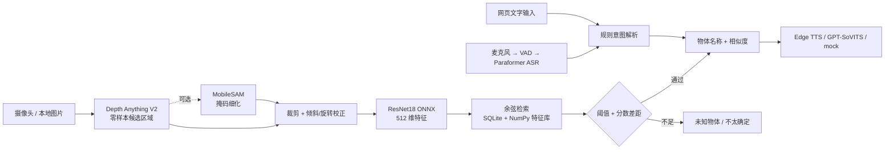

# 离线物体识别与语音助手

> 计算机视觉课程大作业 · 选题一 · Windows / CPU / 本地推理
>
> 用摄像头录入身边的物体，通过 **Depth Anything V2 零样本定位 + ResNet18 特征检索**认出它们，并支持中文语音、文字交互与可视化物体库管理。课程作业项目，仅供学习交流。


**它解决什么问题**：不训练、不微调、不调用云端视觉 API，只靠 ImageNet 预训练 ResNet18 的 512 维特征 + 余弦相似度检索，让用户自己"教"系统认识任意物体；用单目深度找出画面里最近的物体，避免依赖 COCO 固定类别的检测器。

**离线的边界**（重要，避免误解）：

| 环节 | 是否联网 | 说明 |
| --- | --- | --- |
| 视觉推理 / 特征检索 | ❌ 不需要 | ONNX Runtime CPU，模型在本地 |
| 中文语音识别 / VAD / 意图解析 | ❌ 不需要 | sherpa-onnx Paraformer INT8 + Silero VAD + 纯规则 NLU |
| 首次准备模型 | ✅ 需要一次 | `tools/prepare_models.py` 下载 / 导出权重，之后不再需要 |
| 语音播报（默认 `edge`） | ✅ 需要 | Edge TTS 在线合成；可设 `tts.enabled: false`，或改用本地 GPT-SoVITS 实现全离线 |

运行时**不需要** CUDA、OpenVINO 或 PyTorch（PyTorch 仅用于一次性导出模型）。

---

## 核心能力

- **零样本定位**：Depth Anything V2 Small 依据"什么离镜头最近"生成候选区域，不依赖任何类别词表；可选 MobileSAM 用点提示把候选框细化为像素级掩码。
- **特征检索识别**：ResNet18（ImageNet 预训练，取 avgpool 512 维、L2 归一化）与特征库做余弦检索，支持阈值拒识与"分数差距"判断，低分返回「未知物体」、难分返回「不太确定」。
- **录入即建库**：语音或文字命名当前物体，多视角采样 3–10 张，特征落盘到 SQLite + NumPy 矩阵，重启后继续可用；**不重新训练模型**。
- **中文交互**：Silero VAD + Paraformer 中文 ASR；7 类规则意图（识别 / 录入 / 查找 / 删除 / 列表 / 帮助 / 未知），无 LLM、可解释。
- **两个界面**：Flask 浏览器界面（摄像头 MJPEG + 深度热力图 + 对话记录 + 物体库增删改查 + 摄像头/麦克风/识别开关）与 OpenCV 桌面界面。
- **无摄像头也能跑**：本地图片批量录入 / 识别、无模型权重的自动化回归测试、性能基准。

### 本版本整理内容

- 模型准备脚本改用临时工作区：ASR 下载包与解压树不再作为第二份权重残留在 `models/`，并补齐对应回归测试。
- `requirements.txt` 补齐运行期实际依赖 `flask` 与 `pillow`（此前需手动额外安装）。
- `run.bat` / `run.ps1` 去掉硬编码的用户机器路径，改为 `.venv` → `PATH` 自动探测，支持 `VISION_PYTHON` 覆盖。
- 清理 `vision/visualizer.py` 中每次绘制文字都空跑的无用循环、`main.py` 与模型准备脚本中的冗余导入；修正架构文档的相对链接并标注早期方案章节。
- 全部 38 项自动化测试通过（见[验证与排查](#验证与排查)）。

---

## 工作原理



定位与身份是分开的：深度模型只回答"剪哪一块"，物体名称完全来自特征库检索。YOLOv8n 是可选的 ROI / 可视化辅助组件，`config/demo.yaml` 中默认关闭。

> 余弦相似度是特征空间的匹配分数，**不是识别正确的概率**，会受录入样本、视角、裁剪、光照和库内物体影响。

---

## 快速开始

以下命令在项目根目录的 **PowerShell** 中执行。建议使用 Python 3.10 / 3.11（本项目在 3.11.9 上验证）。

```powershell
python -m venv .venv
.\.venv\Scripts\Activate.ps1
python -m pip install -r requirements.txt
```

依赖一次装齐即可，包含 Web 界面的 Flask 与桌面界面中文渲染用的 Pillow。视觉推理使用 ONNX Runtime CPU，无需 CUDA / OpenVINO / PyTorch。

### 一次性准备模型

```powershell
# Web 演示所需的最小组合：ResNet18 特征 + 深度定位 + 中文 ASR / VAD
python tools/prepare_models.py --resnet18 --depth --asr
```

- `--resnet18` 通过 torchvision 导出 ONNX，这一步需要临时安装 `torch torchvision onnx`；导出后运行时不再需要 PyTorch。
- `--depth` / `--asr` 需要联网下载。脚本可能因网络或缺少导出依赖而失败，请检查输出及文件是否存在。
- 可选组件：`--yolo`（YOLOv8n）、`--mobilesam`（掩码细化，导出需 torch 与 mobile_sam）；`--all` 会尝试准备全部组件。
- ASR 包与解压中间产物放在系统临时目录，完成后自动清理，不会在 `models/` 留下重复权重。

主要模型路径由配置文件指定：

| 路径 | 用途 |
| --- | --- |
| `models/resnet18/resnet18.onnx` | 512 维特征提取 |
| `models/depth_anything_v2/depth_anything_v2_vits.onnx` | 单目深度 / 候选区域 |
| `models/sherpa-onnx-paraformer-zh-int8/` | 中文 ASR（int8 + tokens + am.mvn） |
| `models/silero_vad/silero_vad.onnx` | 语音端点检测 |
| `models/mobile_sam/*.onnx` | 可选掩码细化 |
| `models/yolov8n/yolov8n.onnx` | 可选检测辅助 |

`models/` 与 `data/` 下的运行产物不入库（`.gitignore`，仅保留 `.gitkeep`；`data/test_scenes/` 测试图为例外），新克隆的仓库必须重新准备模型。

### 启动浏览器界面（推荐）

```powershell
python web/server.py --config config/demo.yaml
```

打开 [http://127.0.0.1:5000](http://127.0.0.1:5000)。首次启动需要加载模型，按 `Ctrl+C` 停止。`config/demo.yaml` 默认摄像头索引 `0`，可修改 `app.camera_index`。常用选项：

```powershell
# 启动时不占用摄像头和麦克风，可稍后在界面中开启
python web/server.py --config config/demo.yaml --no-camera --no-mic

# 不启用语音输入（仍可用网页文字输入）
python web/server.py --config config/demo.yaml --no-voice

# 修改监听地址 / 端口
python web/server.py --config config/demo.yaml --port 5001
```

默认只监听 `127.0.0.1`。界面中的摄像头、麦克风、识别流水线都可随时开关；摄像头、麦克风或语音模型不可用时，使用页面下方的文字输入框即可。

### 其他入口

```powershell
# OpenCV 桌面界面（launcher 会自动选择 .venv 或 PATH 上的 python）
.\run.ps1 --camera 0 --no-voice
python main.py --config config/demo.yaml --camera 0

# 批量录入 / 识别本地图片，不启动摄像头界面
python main.py --config config/demo.yaml --enroll 水杯 --images data/enroll/cup
python main.py --config config/demo.yaml --recognize data/query/test.png
```

`main.py` 默认读取 `config/default.yaml`（启用 YOLO 与 MobileSAM），Web 演示显式使用 `config/demo.yaml`（两者默认关闭）。批量识别在终端会额外打印最相近候选与分数，便于调试。

---

## 使用方法与指令

1. 打开页面，确认摄像头、模型、麦克风状态灯；也可用文字输入。
2. 将物体完整举到镜头前，说或输入「记住这个，这是手机」。采样期间缓慢调整角度、保持画面清晰。
3. 在右侧物体库点缩略图检查录入样本；若物体被遮挡或截断，重新录入。
4. 举起已录入物体，说或输入「这是什么？」或点击页面快捷按钮。
5. 用右上角按钮暂停 / 恢复识别；物体库支持重命名与删除。

| 意图 | 示例说法 / 文字 |
| --- | --- |
| 识别 | 这是什么？／这是啥／识别一下 |
| 录入 | 记住这个，这是手机／记住，这个叫水杯／记住这个是充电宝 |
| 查找 | 帮我找手机／找一下水杯／手机在哪里 |
| 删除 | 忘掉手机／删除水杯 |
| 列表 | 你记住了什么／记忆列表／列出记忆 |
| 帮助 | 你能做什么／帮助 |

具体匹配规则见 `nlu/intent.py`（有序正则，更具体的模式先匹配，无 LLM；上表例句均已用解析器验证）。

---

## 配置与阈值

`config/demo.yaml` 中的关键项：

| 配置 | 当前值 | 作用 |
| --- | --- | --- |
| `memory.center_features` | `true` | 满足条件时减去特征库共同成分再计算相似度 |
| `memory.match_threshold_centered` | `0.5` | 中心化特征的拒识阈值 |
| `memory.margin_threshold_centered` | `0.15` | Web 识别中第一名与第二名所需的最小分数差 |
| `memory.match_threshold` | `0.7` | 未启用中心化时使用的阈值 |
| `memory.min_samples` / `max_samples` | `3` / `10` | 一次录入的样本数下限 / 上限 |
| `memory.sample_duration_sec` | `2.5` | 正常采样窗口（秒） |
| `memory.sample_timeout_sec` | `15.0` | 样本不足时的总时限（秒） |
| `depth.use_mobilesam` | `false` | 是否启用可选掩码细化 |
| `yolo.enabled` | `false` | 可选检测辅助 |
| `debug.enabled` | `true` | 是否记录调试画面 |

中心化至少需要两个不同的已录入物体；未满足时自动退回普通特征及对应阈值。物体增删后均值会变化，分数也可能变化。**0.5 是当前演示的拒识设置，不是通用最优阈值**：调高可减少误识别，也会增加把已录入物体判为未知的情况；换数据集请重跑 `tools/eval_dataset.py` 或 `tools/calibrate_threshold.py` 标定。

网页摄像头识别、桌面识别、本地图片批量识别的裁剪与判断流程并不完全相同，实际使用应分别验证。

---

## 数据与模型存储

| 路径 | 内容 |
| --- | --- |
| `data/visual_memory.db` | SQLite：物体名称、样本索引等元数据 |
| `data/resnet18_embeddings.npz` | 特征矩阵缓存 |
| `data/samples/<物体名>/` | 录入样本图片和对应 `.npy` 特征 |
| `data/debug/` | 启用调试记录时的画面、候选区域与识别报告 |
| `data/test_scenes/` | 已入库的场景级测试图与来源说明 `manifest.json` |
| `models/` | 本地模型文件（不入库） |

保留数据库、特征和样本文件即可在重启后继续使用物体库。调试画面可能包含摄像头中的人物与环境，请按需管理；设置 `debug.enabled: false` 可关闭记录。

---

## 语音播报与全离线使用

`config/demo.yaml` 默认 `tts.mode: edge`，需要网络。

| `tts.mode` | 联网 | 说明 |
| --- | --- | --- |
| `edge`（默认） | 需要 | 微软 Edge TTS，延迟低、音色自然 |
| `gpt_sovits` | 不需要 | 独立进程加载本地 GPT-SoVITS，CPU 上较慢（RTF ≈ 1.3） |
| `mock` | 不需要 | 提示音 / 静默，仅用于测试 |

只需本地视觉识别与语音输入时，设 `tts.enabled: false` 即可，视觉功能不受影响。需要离线播报时，在独立环境启动本地服务并把 `tts.mode` 设为 `gpt_sovits`，检查 `tts.server_url`、参考音频及与之逐字一致的 `prompt_text`；服务入口见 `voice/tts_server.py` 与 `tools/start_tts_server.bat`（后者含本机路径，使用前需修改）。

---

## 验证与排查

```powershell
# 无摄像头 / 无模型权重的自动化回归测试（38 项）
python -m unittest discover -s tools -p 'test_*.py' -q

# 冒烟测试、场景级功能测试与可选性能基准
python tools/smoke_test.py
python tools/run_feature_tests.py
python benchmark.py --skip-asr --skip-tts
```

自动化检查覆盖采样时限、深度候选、前景/肤色剔除、纸巾颜色细节、旋转处理、拒识响应与模型准备流程；它们**不能代替真实摄像头下的识别测试**。定位失败时可查看 `data/debug/` 的原图、候选裁剪和报告。历史评测结果与阈值不能直接代表当前中心化配置或新场景效果。

常见问题：

- **页面打不开**：确认终端无启动错误、端口未占用，访问正确的本机地址。
- **模型未加载**：检查配置路径、模型文件与准备脚本输出。
- **摄像头无画面**：检查设备权限、索引、是否被其他程序占用，或在界面中重新开启。
- **录入样本不足 / 不完整**：把完整物体放在画面中央，保证光线，适当调整角度后重试。
- **已录入物体显示未知**：查看录入样本与当前裁剪；倾斜校正无法解决严重遮挡、透视变化或定位不完整。
- **没有语音播报**：检查 `tts.mode`、网络或本地 TTS 服务；视觉识别可独立使用。

---

## 项目结构

```text
main.py                     桌面界面 + 本地图片批量录入 / 识别入口
benchmark.py                性能基准
web/
  server.py                 Flask 服务：MJPEG 视频流、深度图、状态与物体库 API
  templates/index.html      浏览器界面
core/                       应用编排、配置加载、调试记录
vision/                     深度定位、MobileSAM、特征提取、检索、裁剪、摄像头、渲染
voice/                      ASR、VAD、麦克风、TTS 客户端与独立 TTS 服务
nlu/intent.py               中文规则意图解析
ui/text_input.py            无麦克风时的文本输入窗口
mobile_sam/                 MobileSAM 推理代码（含 LICENSE）
config/
  demo.yaml                 Web 演示配置（推荐）
  default.yaml              桌面界面默认配置，注释最完整
tools/                      模型准备、测试、评测与维护脚本（见下表）
docs/                       架构文档、深度定位技术报告、演示截图
models/  data/               本地模型与运行数据（均不入库）
```

`tools/` 脚本按用途分组（文件名保持原样，避免破坏既有命令）：

| 类别 | 脚本 |
| --- | --- |
| 模型准备 | `prepare_models.py`、`start_tts_server.bat` |
| 自动化回归测试 | `test_enrollment.py`、`test_identification.py`、`test_depth_regions.py`、`test_model_preparation.py` |
| 场景 / 链路测试 | `smoke_test.py`、`run_feature_tests.py`、`capture_live_ui.py`、`test_depth_localization.py` |
| 评测与标定 | `eval_dataset.py`、`calibrate_threshold.py`、`ab_yolo.py`、`ab_yolo_scene.py` |
| 数据准备 | `fetch_dataset.py`、`fetch_test_scenes.py` |
| GPT-SoVITS 维护 | `tts_server.py` 配套：`trim_gpt_sovits.py`、`export_infer_weights.py`、`verify_export_pipeline.py`、`verify_tts_server_config_isolation.py`、`probe_tts_deps*.py`、`retest_tts_deps.py`、`trace_tts_deps.py` |

---

## 已知局限

- 使用分类模型提取的视觉特征，外观相近的物体（如碗 / 马克杯）仍可能被混淆；少量样本难以覆盖所有视角、光照和遮挡。
- 深度候选有时会包含手或背景，或截掉物体的一部分；阈值与角度校正只能改善部分场景，不能保证零误识别。
- 界面帧率不等于每次识别的推理速度；CPU 上深度推理约数百毫秒，独立于界面刷新。
- 特征库为单机 SQLite + 内存矩阵，适合几十到几百个物体的课程规模。

---

## 文档

- [README.md](README.md) — 使用说明（本文）
- [docs/ARCHITECTURE.md](docs/ARCHITECTURE.md) — 设计取舍与实测结论（部分章节记录早期方案，已标注）
- [docs/zero_shot_depth_localization.md](docs/zero_shot_depth_localization.md) — 深度引导零样本定位技术报告
- `人工智能视觉课程大作业选题书.docx` — 课程选题书

## License

课程作业项目，仅供学习交流使用。第三方组件 `mobile_sam/` 遵循其自带 [LICENSE](mobile_sam/LICENSE)；模型权重各自遵循上游许可。
